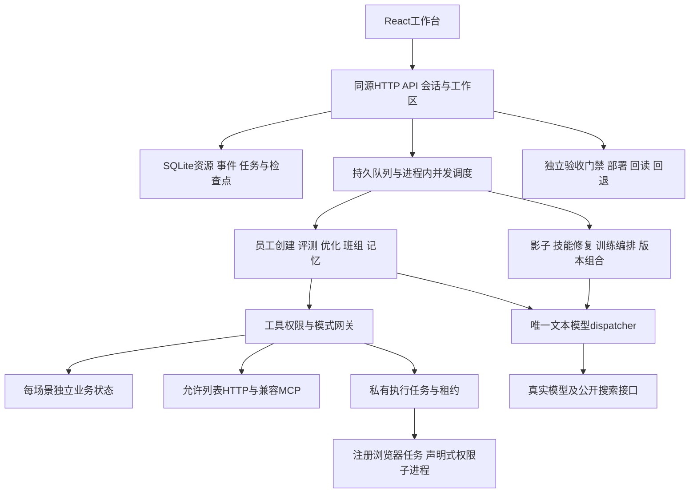

# 系统架构与执行契约

秀吉系统 是独立的数字员工评测与迭代控制平台。前端管理岗位与实验，后端冻结版本、编排真实模型和工具调用，私有执行器承担获准的浏览器和声明式脚本任务。员工运行、仿真业务、评分与部署是不同环节，界面和报告分别记录其模式和证据。

本文以当前源码为准。架构行为依据为A，测试和运行记录依据为B；未接通的外部环境不能由架构推定已生效。功能及验证层次见 [功能矩阵](FEATURE-MATRIX.md)。

## 模块与主要调用链

| 文件                               | 职责                                                                   |
| ---------------------------------- | ---------------------------------------------------------------------- |
| `server/index.mjs`                 | API、角色、工作区、数据导入、任务调度、节点租约、导出及运行服务        |
| `server/store.mjs`                 | SQLite事务、资源修订、不可变证据、事件链、用户会话与幂等               |
| `server/model.mjs`                 | 模型配置、窗口和预算、出站与结算回执、JSON与身份校验、搜索与正文读取   |
| `server/engine.mjs`                | 初版生成、快照、工具循环、断言、裁判、报告、迭代、检查点和协作评测     |
| `server/tools.mjs`                 | 仿真、HTTP、MCP、权限收紧、审批、幂等、故障与私有任务等待              |
| `server/advanced.mjs`              | 技能修复、影子、时序记忆、经验白名单复用、Pareto、训练与部署契约       |
| `server/safe-http.mjs`             | URL、主机、DNS及私网限制，响应大小和重定向控制，支持范围内的Schema校验 |
| `scripts/runner.mjs`               | 认证领取任务、续租、注册任务执行与结果上报                             |
| `scripts/runner-script-worker.mjs` | 无任意代码求值的声明式数据转换                                         |

Node 24及以上运行服务与权限执行器，React/Vite构建浏览器界面。生产构建后的静态界面和API可由同一个Node进程提供；数据库是SQLite，源码没有依赖另一个尚未配置的云数据库。并发调度器在单个服务进程内管理，默认并发2、设置范围1–5。当前架构不把多个控制面进程当作已有分布式调度集群。

## 存储与资源模型

SQLite使用WAL、外键和busy timeout。核心表如下：

| 表            | 关键字段与约束                                                                                                       |
| ------------- | -------------------------------------------------------------------------------------------------------------------- |
| `resources`   | 主键 `(workspace,kind,id)`；`revision,data,created_at,updated_at`；按工作区/类型/更新时间索引；data保存对应领域JSON  |
| `events`      | 自增seq、workspace、kind、subject_id、data、previous_hash、hash、created_at；按工作区/对象索引；触发器拒绝更新和删除 |
| `users`       | 唯一email、密码scrypt散列与盐、workspace、role                                                                       |
| `sessions`    | token摘要、user_id、expires_at；不保存明文会话token                                                                  |
| `idempotency` | 主键 `(workspace,key)`；request_hash与结果；同key不同请求拒绝                                                        |

领域资源分为以下几组：

- 岗位与能力：employees、versions、knowledge、tools、skills、models、teams、memories。
- 评测与改进：datasets、cases、jobs、runs、optimizations、reports、reviews、checkpoints。
- 执行和交付：executions、nodes、approvals、deployments、training、experiences。
- 配置和模型证据：settings、receipts。

资源更新增加revision，使用`expectedRevision`做乐观冲突检查。冻结的versions、runs、reports、receipts和checkpoints禁止修改和删除。资源与相应事件在同一事务写入。事件链用于发现一致性变化，不能被表述为可信执行者签名或对数据库管理员的不可抵赖证明。

## 员工版本与实验条件

员工身份稳定，版本不可变。版本manifest包含岗位指令、知识/工具/技能ID、完整资产快照及源修订、模型快照、权限、检索参数、记忆策略、外部员工接入方式、运行器标识和可用虚拟搜索工具。模型资源中的pricing也随快照冻结；历史快照缺少费率时，具体采用费率仍由模型回执pricingSnapshot记录，不回写旧版本。`manifestHash`绑定这份配置。

冻结保护历史实验的解释能力，授权检查保护当前访问边界：执行前仍读取live资源，撤销的知识、技能、工具和模型不能通过旧快照继续使用；工具权限、只读模式和网络允许列表可以继续收紧。`engine.validateVersion()`供部署与回退复用同一检查。

独立evaluate的run另冻结测试集修订、用例摘要、评分策略、最低分、模型配置、重复次数和工具模式；班组与记忆run使用各自family的执行与序列清单：

- `datasetHash`：数据集来源、用途、修订、caseHashes、rubric及晋级策略。
- `workerModelConfigHash`：被测员工的冻结模型配置摘要，权重或模型选择可以是实验独立变量。
- `judgeModelConfigHash`：本次固定裁判的完整配置摘要；`modelConfigHash`保留为该字段的兼容别名。
- `evaluatorHash`：评分策略、模型配置摘要、最低分与硬断言策略。
- `comparisonHash`：数据、裁判、重复次数和模式的共同条件。

两个run只有数据、裁判、模式和样本配对均匹配，才进入正式比较。被测worker模型可以不同；裁判模型名称相同而thinking、端点或参数变化，仍不算同条件。供应商canonical别名可能映射更新；保存配置和响应标识不等于控制了供应商底层权重的永久不变性。

## 模型调用、搜索与费用不明

所有文本生成、裁判、优化和记忆调用通过`model.complete()`，没有隐式换供应商、规则模型或mock降级。当前默认注册表为`deepseek-flash`，展示版本`DeepSeek-V4.1-Flash-1017`，注册表核实日期为2026-11-04；具体事实来源记录在[模型注册表](../server/model.mjs)及[DeepSeek官方说明](https://api-docs.deepseek.com/quick_start/pricing/)。

dispatcher保留工具对话所需的瞬态`reasoning_content`，证据和导出不保存原始思考内容。结构化场景要求JSON对象；空输出、截断、错误结束、模型标识不一致或用量无效均拒绝。

被测、仿真用户、评分和改进是分离的调用角色，默认仍使用同一已核实DeepSeek模型，不进行隐式供应商降级。独立evaluate的评分模型可明确指定：参数`judgeModelId`优先于测试集`judgeModelId`，再优先于工作区`defaultJudgeModelId`；均未指定时兼容使用被测版本模型。独立评测开始即冻结judge配置，优化任务的基线、候选和阶段验证共用这一份裁判快照。显式选择独立裁判是评测角色配置，不是业务文本生成中的隐式换模。禁出域知识也会针对独立裁判重新检查，local worker不能借remote judge泄露资料。

需求创建优先使用明确传入的模型，其后为`settings.defaultModelId`、初始DeepSeek连接或唯一可用模型。有多个模型而无明确默认时拒绝歧义，不因新权重模型成为资源列表首项就切换默认。新训练候选不自动改变工作区默认模型。

窗口和任务预算分开处理：完整请求的输入估算带有明确方法标签，合法输出上限从模型窗口和配置上限推导，再受用户任务剩余额度约束。当前计数是保守估算，不称为官方tokenizer精确计数；实际结算采用供应方usage。预算不足在出站前拒绝，不通过静默裁剪输入满足额度。

调用前追加`dispatching`回执并持有预留；有效usage后追加`settled`，接受业务输出后追加`completed`。确定未接受的HTTP错误记为`not_accepted`；结果或用量不明保留`unresolved`。进程重建后，从持久回执重算未结尝试。相同`semanticHash`存在未结请求时，另开任务也不能重发。管理员核对需要供应商依据；标为`completed`时还需回执ID和完整usage。系统保存的是管理员提供的核对证据，不假称已经替管理员查询过供应商后台。

Flash公开联网采用单独`/v1/tools/search`和`/v1/tools/fetch`桥接，作为只读函数工具进入员工循环，不把聊天请求里的一个search布尔值当成已经搜索。版本冻结搜索可用性，岗位`allowSearch=false`可进一步收紧。发送前检查联系方式、凭据、业务客户标识、未授权知识原文及私有正文地址。搜索、正文和业务工具回执分别记录。

dispatcher可按模型价格快照区分缓存输入、非缓存输入和输出估算costUSD；员工、仿真用户和裁判用量保留此字段。核心evaluate、team_evaluate和memory_evaluate完整且所有实际平台模型调用都有已知估算时，metrics包含`costUSD`、`costBasis=USD_estimate`及`costScope=platform-model-calls-only`。缺少费率或结果不完整则使用tokens代理，不伪造零费用。公开搜索、正文、外部工具和远端员工的未知费用没有混入该估算，USD估算也不等于供应商结算账单。

## 场景执行与评分

每个case有初始状态、输入、预期、故障和断言；重复执行重新克隆状态。员工只能看到任务、获准知识、技能和当前范围的记忆，看不到预期答案或验收断言。模型用户模拟只负责交互，不修改业务状态。

业务工具动作必须有实际回执。确定性验收支持状态比较、应包含/不应包含文字、工具调用、产物存在和无违规；语义裁判独立评价任务和证据。失败断言或违规不能由高语义分抵消。评分失败算评测不完整，未执行场景保留在计划分母内。

工具运行模式与模型模式分别保存：`modelMode=real`可与`toolMode=simulated`同时出现。外部HTTP员工仅在test模式调用；远端输出和远端自报状态分开保存，自报状态不代替独立业务观察。模型说“完成”也不会直接改变仿真订单。

指标保留首轮通过率、重复稳定性和独立场景置信区间。模型随机性、场景覆盖不足和来源可信度仍是报告限制。人评生成新报告的adjudication引用，原run/report保留，不能通过人工pass消除硬规则失败。

## 场景检查点、重启与恢复

一个场景完成或得到明确error后，立即在事务内写入不可变checkpoint并更新job.checkpointIds，再报告进度。检查点包含job/version/dataset、用途、输入/配置/结果摘要、caseId、repeat和完整caseResult。组级run尚未写入时，完成场景仍可从检查点追溯。

服务启动把遗留running任务标为interrupted，不冒充任务成功，也不自动恢复真实外部写入。`POST /api/jobs/:id/resume`只允许独立evaluate任务，来源状态为interrupted/failed/cancelled、模式为simulated、原预算尚有余额，且该任务没有未核对的供应方尝试。

引擎进一步校验员工版本、测试集、重复次数及输入、数据、裁判摘要。已完成或明确error的case原样复用，不重发原请求；仅余下场景继续。新检查点保留来源，manifest记录`resumedFromJobId`；复用tokens和本任务新增用量分列。磁盘SQLite关闭重开测试覆盖了这条路径。

此恢复范围是case边界，不是任意指令点恢复。进行中的未确认模型请求必须先核对；test/production外部动作不会因恢复入口被重复执行。团队、优化、微调和长期记忆任务不通过这个接口被伪装成可自动重启的独立评测。

## 自动迭代与数据隔离

需求创建只引用当前工作区获准资产，不编造缺失接口或知识。目录中的知识必须已发布，且可用于所选模型；draft、停用、撤销或当前无权使用的资产不会被自动采纳。工具只提供公开输入/输出Schema、操作和仿真resource，省略密钥引用、端点、测试参数与客户状态，Schema默认值和示例也不进入创建请求。生成结果先校验，再以事务写入员工、初版、技能和开发集。依赖缺口保留在员工与结果中。

自动优化只能读取train/dev；隐藏题和holdout拒绝。允许修改岗位指令、绑定技能的声明式内容和步骤，以及冻结检索参数，不允许改工具权限、模型、知识事实、评分标准或测试答案。检索默认`{topK:8,chunkSize:1400,overlap:300,minScore:0}`，topK为1–30整数、chunkSize为256–8000整数、overlap为0–2000整数且小于块长、minScore为0–1000。参数实际控制切块、命中阈值和选取数量；仅检索参数变更也会创建实质候选。

候选使用冻结父依赖，按相同条件重测；有关键退化、违规、未完成或没有实质改动时不晋级。知识发布回归可用`refreshKnowledgeIds`显式更新父版本已绑定的指定知识，前提是新修订已发布且授权出域；其余知识、工具、技能和模型仍继承父快照。优化器没有这个字段的修改权，不能借检索调参刷新业务事实。最佳候选只形成建议，不直接覆盖生产指针。

工作区`autoKnowledgeRegression`默认false；开启后，知识由草案发布或已发布内容变更时，知识保存与`knowledge_regression`排队在同一事务完成，按知识ID和修订幂等。任务查找绑定该知识的当前员工版本，或使用明确指定的父版本，生成仅更新该知识的候选；使用已有train/dev回归集重新运行父子版本并保存比较报告。没有已有回归集时保留候选和gap，不冒充已经评测。排队修订已被后续内容更新替代时拒绝把新内容当成原发布修订。此机制不自动部署候选。

validation用于阶段验证，其细粒度结果不回喂优化器。holdout通过API只公开限定摘要，包含参数、状态、断言和裁判文字的详细轨迹不会进入普通报告或检查点导出。数据集用途、生成来源及场景归属不能通过通用编辑接口改写，以免把开发成绩转换为独立验收证据。

## 私有执行器与网络边界

节点以一次性令牌登记，服务只存token摘要。执行器在自己的工作区领取匹配能力和节点范围的任务，使用leaseId续租并提交结果。过期租约和旧结果拒绝；结果不明任务不会自动重新派发外部写动作。

声明式脚本是固定数据转换指令，使用Node权限子进程、空环境、内存/时限/输出限制。没有eval、任意shell或上传代码即执行路径。浏览器使用独立Playwright上下文，注册步骤限定允许主机、动作和变更权限，禁下载与service worker，HTTP流量经受控请求路径，WebSocket被关闭。

`safe-http.mjs`校验协议、凭据、允许主机、DNS和私网地址，固定已解析地址发送，拒绝重定向并限制响应体。工具自己的允许列表只能收紧管理员列表。HTTP、MCP和浏览器验证都不等于操作系统级多租户安全认证，部署者仍需为执行机器配置实际网络和运行账户边界。

MCP适配器当前显式支持`2025-06-18`和`2025-11-25`握手，处理JSON与匹配请求的SSE结果、会话及协议头。它不是对所有后续MCP协议版本的兼容承诺。Schema校验只接受实现支持的关键字；不支持的关键字报错，不能默默跳过后宣称完整JSON Schema兼容。

## 发布、回退与不明结果

发布门禁要求完整、无违规且达到配置阈值的冻结独立holdout记录。真实发布还要求至少30个独立场景、95% Wilson下界达到至少0.9、真实模型模式，拒绝仅外部自报业务状态的证据。少量开发题的高分不能直接授予发布资格。

本地模拟部署仅变更平台员工版本指针，回执明确simulated。真实部署目标需要实现POST动作和独立GET `/status?employeeId=...`回读契约。提交携带requestId，只有版本和回执均匹配才更新本地指针。

按员工持久锁定deploying、rolling_back和uncertain，避免并发部署覆盖。出站后超时或回读失败转uncertain；核对入口仅GET读取，不重复POST。核对成功后按requestId/receiptId及目标版本更新指针。服务重启后未完成真实部署保持uncertain。回退同样校验当前指针与前版本授权，不能覆盖更晚部署。

上述是可接入的交付协议与已做本地HTTP验证，不能写成某个生产云或客户运行系统已经部署。

## 训练、记忆、经验与版本组合

权重训练使用显式`workloom-async-v1`提供方契约：POST接收baseModel、训练messages、配置及clientRequestId；GET任务ID返回状态，succeeded必须有resultModel。只有train集合可导出。当前DeepSeek配置明确拒绝托管微调，外部接口fixture测试证明的是编排和回执处理；本项目没有据此生成或宣称真实训练出的模型权重。

训练提交记录冻结当时的员工基线和提供方推理配置。`POST /api/training/:id/create-version`只接受任务ID一致的成功提供方回执和结果模型，校验当前授权及快照中的HTTPS推理地址、密钥引用和窗口配置，注册`default=false`模型并创建员工权重候选。其他知识、工具和技能保留训练提交时的父快照；重复请求复用已创建候选。该动作不改变当前员工或默认模型。新旧权重进入相同测试集与固定裁判配置后才能公平比较。

长期记忆以员工、scope、批准和过期时间过滤。评测内候选可用于后续时序步骤，持久化时仍标记evaluationOnly、approved=false，不进入生产记忆。班组按冻结成员顺序执行，授权交接与共享记忆分别记录。

经验服务只复制获批shared摘要的name/summary/tags，不复制原始轨迹和客户数据；目标生成未审知识草案并默认禁止模型出域。跨工作区调用必须由受信后端检查来源与目标审批，普通请求不能选择任意工作区。

Pareto组合只比较同员工、同冻结条件下的完整run，在质量、tokens或已有costUSD、时延之间保留非支配候选。没有货币成本时明确使用tokens，不把建议当作生产部署。

## 运行配置与验证位置

默认服务地址是`http://127.0.0.1:4317`，SQLite文件为`.runtime/eval.sqlite`。本地认证只能绑定回环。远端运行需密码模式、初始管理员及实际部署网络配置；提供源码和启动方式不表示远端服务已上线。

密钥仅从环境或专用会话接口解析。通用资源拒绝凭据字段和常见密钥字符串；事件和导出不回显密钥。知识导入默认禁止模型出域，只有明确授权的资料才可发送给相应模型。

测试入口包括`tests/engine.test.mjs`、`tests/model.test.mjs`、`tests/store.test.mjs`、`tests/api.test.mjs`、`tests/advanced.test.mjs`和`tests/review.test.mjs`。其中本地HTTP、浏览器、权限子进程和SQLite测试使用真实运行组件；模型stub会在测试代码中明确出现。真实DeepSeek初始创建和5场景基线的独立记录见功能矩阵中的任务/run/report标识。所有外部环境验收应继续保留自己的来源、模式和实际回执。
